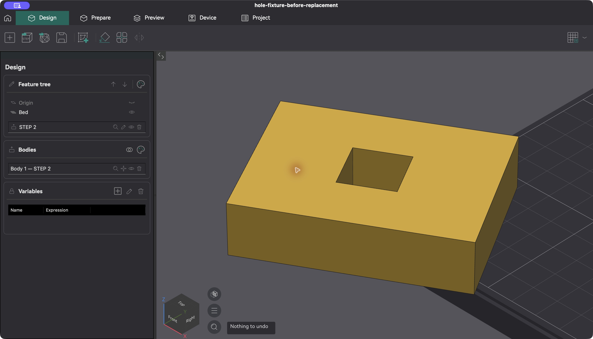
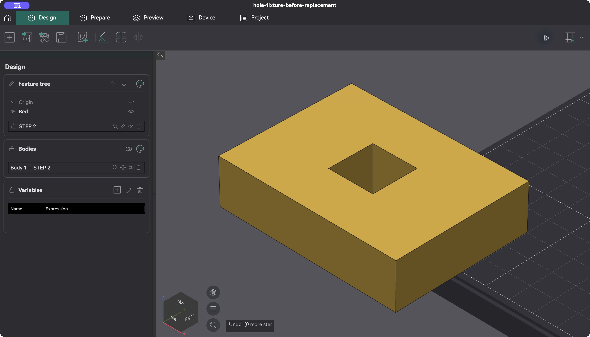

# CAD contribution verification

macOS arm64, Release, CAD enabled. These are two independent contributions against `d76276778c1879373eef4f49055b685fba8d41be`:

| Contribution | Source commit | Full contribution code checks | Selected Release tests |
| --- | --- | --- | --- |
| CAD selection and read-only geometry API | `4de48d5209a63674c44096046632761811889e97` | Passed, all 20 changed C++ files | 328 passed, 0 failed, 0 skipped |
| Design body placement Undo/Redo | `b9193e6c5fdee283d91c7c0780a8d48428f4b2b8` | Passed, all 5 changed C++ files | 262 passed, 0 failed, 0 skipped |

[Full contribution code checks](https://github.com/Garth-42/OrcaSlicer/actions/runs/42957119565) use the repository's `scripts/run_clang_tidy.sh` against the original contribution base, with precompiled headers disabled. The Python sample parses and both complete diffs pass the whitespace check.

[Release builds and regressions](https://github.com/Garth-42/OrcaSlicer/actions/runs/42957716231) record the exact source commit in each artifact. The selected API suites are CadDocument, CadShape, CadFaceSelection, PluginCadGeometry, DesignSketchTool, PluginLifecycle and PluginHost. The placement suites are CadDocument and DesignSketchTool. The existing NotWorking label is excluded. This was not a run of the entire repository's CTest collection.

## Tests detect the original defects

- Removing the plugin selection-cache lifetime fix reproduces the process-finalization mutex abort, exit 134. Restoring the fix passes the shutdown case, including normal process exit (2 assertions).
- Removing placement storage from history produces four failing placement assertions, exit 42. Restoring the fix passes all 18 assertions in the case. The additional placement case checks redo invalidation and clearing a design.

## Desktop verification

The model is an [80 × 60 × 20 mm block with a centred 20 × 20 mm through-hole](rectangular-through-hole.step). Import it in Design; save and reopen the project to start with empty undo history. Printer profiles do not affect these operations.

For the placement comparison, confirm a 30° Z rotation, finish the tool, then Undo. The original feature build (`2df6f4b4a245b7410d2120c0dc070adf43488b7e`, Actions run 42409988660) retains the rotation and reports “Nothing to undo”. Its placement implementation matches the contribution base. The focused placement build restores the original orientation. Redo, a cancelled 25 mm preview and an unchanged confirmation also behave correctly. Undoing a deletion restores the rotated body.

| Before | After |
| --- | --- |
|  |  |

[Cancel and unchanged confirmation](placement-cancel-noop-undo.jpg) · [Deletion restoration](placement-deletion-undo.jpg)

After clicking the body row's delete control, focus moved into the Variables grid. Undo restored the body after focusing the viewport. This records the focus condition used for the successful check.

For the API, run the sample inspector and select the broad top face. It reports area 4,400 mm², centroid (0, 0, 20), and two complete four-edge loops: one outer boundary and one inner hole. Native edge → vertex → face picks report revisions 4 → 5 → 6, with inactive indices cleared. The vertex is (-40, 30, 20). [Complete GUI selection records](api-gui-selections.json) accompany the screenshots.

[Selected face](api-selected-face.jpg) · [Area](api-face-area.jpg) · [Boundary loops](api-boundary-loops.jpg) · [Vertex fields](api-vertex-fields.jpg) · [Face clears vertex](api-face-clears-vertex.jpg)

Both focused apps quit normally with exit 0. The API inspector subscription was active at quit. Test configurations were isolated and the original project was not overwritten. The contributor observed and confirmed the earlier macOS verification.

Screenshots are raw captures, without cropping, annotation or retouching. Local review copies have distinct bundle identifiers and display names so desktop controls can distinguish them. Executable hashes were unchanged; release archives and source branches were not modified. [Screenshot hashes and provenance](screenshot-manifest.json) · [Structured verification](verification-summary.json)

Windows and Linux desktop behavior has not been tested. No additional checks on those operating systems were required or awaited for this split.
